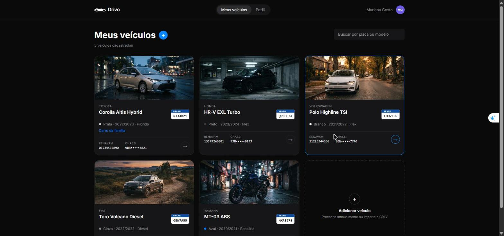

# Drivo

Plataforma onde o usuário monta a garagem dele: cadastra os veículos, pesquisa,
edita, exclui e importa o CRLV para a IA do Gemini preencher o formulário sozinha.

Teste de Desenvolvedor Fullstack Júnior (EPTA).

Protótipo no Figma: https://www.figma.com/design/kMDaB78808CbApQRhg8kVF/Untitled?node-id=1-833&t=HL0fcN1gkWiim6VF-1



---

## O que dá pra fazer

Criar conta, fazer login, ver a garagem, pesquisar por placa ou modelo,
cadastrar veículo, importar o CRLV e ter os dados preenchidos pela IA, editar,
excluir, alterar os dados cadastrais e a senha, e sair da conta.

## Stack

| Parte | O que usei |
| --- | --- |
| Front | Next.js 14 (App Router) + TypeScript + Tailwind |
| Back | Fastify 5 + TypeScript |
| Banco | PostgreSQL 16 + Prisma |
| Login | JWT + bcryptjs |
| IA | API gratuita do Google Gemini |
| Docs | OpenAPI com `@fastify/swagger` |
| Testes | Vitest |
| Infra | Docker + docker-compose |

---

## Como instalar e executar

Só precisa do Docker.

```bash
git clone <url-do-repositorio>
cd drivo-platform
cp .env.example .env
```

Abra o `.env` e coloque a chave do Gemini (gratuita em
https://aistudio.google.com/apikey):

```env
GEMINI_API_KEY="sua_chave_aqui"
```

Depois:

```bash
docker compose up --build
```

Ele sobe o banco, espera ficar pronto, aplica as migrations, roda o seed e sobe
a API e o site. A primeira vez demora alguns minutos.

| | |
| --- | --- |
| Site | http://localhost:3000 |
| API | http://localhost:3333 |
| Documentação | http://localhost:3333/docs |

O seed cria uma conta com os 5 veículos do Figma:

```
mariana.costa@email.com / drivo1234
```

> Sem a chave do Gemini tudo funciona, só a importação do CRLV que dá erro.
> A cota gratuita é de 20 requisições por dia por modelo; se estourar, dá pra
> trocar o `GEMINI_MODEL` no `.env`.

### Sem Docker

Precisa de Node 20+ e um PostgreSQL rodando.

```bash
cd backend && npm install && cp .env.example .env
# troque "banco" por "localhost" na DATABASE_URL
npx prisma migrate deploy && npm run seed && npm run dev

cd frontend && npm install && cp .env.example .env.local && npm run dev
```

## Como executar os testes

```bash
cd backend
npm test
```

São 27 testes das validações (e-mail, senha, placa, formulário) e da leitura da
resposta do Gemini. Dentro do Docker: `docker compose exec backend npm test`.

## Rotas

Todas documentadas em http://localhost:3333/docs.

`POST /auth/cadastro` · `POST /auth/login` · `GET|POST /veiculos` ·
`GET|PUT|DELETE /veiculos/:id` · `POST /veiculos/crlv` · `GET|PUT /perfil` ·
`PUT /perfil/senha`

O token vai no header `Authorization: Bearer <token>`.

---

## Decisões técnicas

**Fastify em vez de NestJS.** O Nest ia me obrigar a
criar module, controller e service pra cada recurso sem me dar nada em troca.

**TypeScript nos dois lados, com `strict`.** Ter os tipos `Veiculo` e `Usuario`
escritos num lugar só evitou erro de campo trocado entre o back e o front. Deixei
`as` no corpo das requisições, porque o schema do Fastify já validou o formato
antes, e `any` na resposta do Gemini, que é um objeto grande do qual eu uso um
campo só.

**Prisma.** Resolve migration, client e seed de uma vez, e o `schema.prisma`
serve de documentação do banco.

**Token no `localStorage`.** localStorage fica exposto a XSS. Escolhi pela simplicidade 
e deixei nas limitações.

**Logout só no front.** JWT não dá pra invalidar no servidor sem uma lista de
tokens revogados (e isso não era requisito).

**Gemini com `fetch`, sem SDK.** É uma chamada HTTP só; o SDK seria dependência
sem ganho.

**Separei a leitura da resposta do Gemini numa função própria.** Mesmo pedindo
só o JSON, às vezes ele devolve dentro de um bloco markdown e o `JSON.parse`
quebra. Separando consegui testar os dois formatos sem gastar chamada de API.

**Repito a chamada quando dá 503, mas não quando dá 429.** A API gratuita fica
sobrecarregada de vez em quando e devolve 503, isso passa em segundos, então
repetir resolve. Já o 429 é cota estourada, que só libera depois. Repetir em
2 segundos não ia adiantar e ainda gastaria mais requisição Separei as mensagens: 
se for 503 ou 429 a tela avisa que a IA está ocupada, em vez de mandar a pessoa 
trocar de arquivo.

**Modelo do Gemini em variável de ambiente.** Comecei com o `gemini-2.5-flash` e
no meio do projeto o Google parou de liberar ele pra contas novas. A troca foi
só mexer no `.env`.

**Busca feita no banco.** No começo eu trazia tudo e filtrava em memória. Passei
pro Prisma com `OR` em placa, marca, modelo e apelido. O `mode: insensitive` é o
que faz o Postgres ignorar maiúscula.

**CORS preso a uma origem.** A API só aceita chamada do endereço em
`CORS_ORIGIN`. Liberar pra qualquer origem deixaria qualquer site chamar a API
pelo navegador de quem estivesse logado.

**Token expirado desloga sozinho.** O `chamarApi` vê o 401, joga o token fora e
manda pro login — menos nas rotas `/auth`, onde 401 significa senha errada.

**Valido nos dois lados.** A tela pra responder rápido, o backend porque não dá
pra confiar no que chega na API.

**A rota do CRLV não salva nada.** Ela lê e devolve; quem salva é o
`POST /veiculos`. A IA pode errar e o usuário precisa conferir antes.

---

## Limitações

- Token no `localStorage`, vulnerável a XSS.
- Sem refresh token, o token dura 7 dias.
- Sem paginação na listagem.
- Sem upload de foto do veículo. Os carros do seed têm foto porque subi as
  imagens junto; veículo novo fica com fundo neutro.
- Só testei o backend, não escrevi teste de componente.
- A leitura do CRLV depende da qualidade do arquivo. Com um CRLV real ele acertou
  todos os campos, mas testando o mesmo documento numa imagem pequena ele
  confundiu letra com número no chassi e na placa. Por isso a tela nunca salva
  direto: a pessoa confere antes.
- Sem rate limit no login e no upload.
- Cota gratuita do Gemini de 20 requisições por dia, por modelo.

## O que eu faria com mais tempo

1. Cookie `httpOnly` com refresh token, no lugar do localStorage.
2. Testes de integração com um Postgres de teste, e testes de tela.
3. Índice no banco pros campos da busca, e paginação.
4. Upload de foto do veículo.
5. Mostrar lado a lado o que a IA leu e o que estava preenchido, antes de aplicar.
6. Rate limit no login e no upload.
7. Máscara nos campos de placa, Renavam e chassi.
